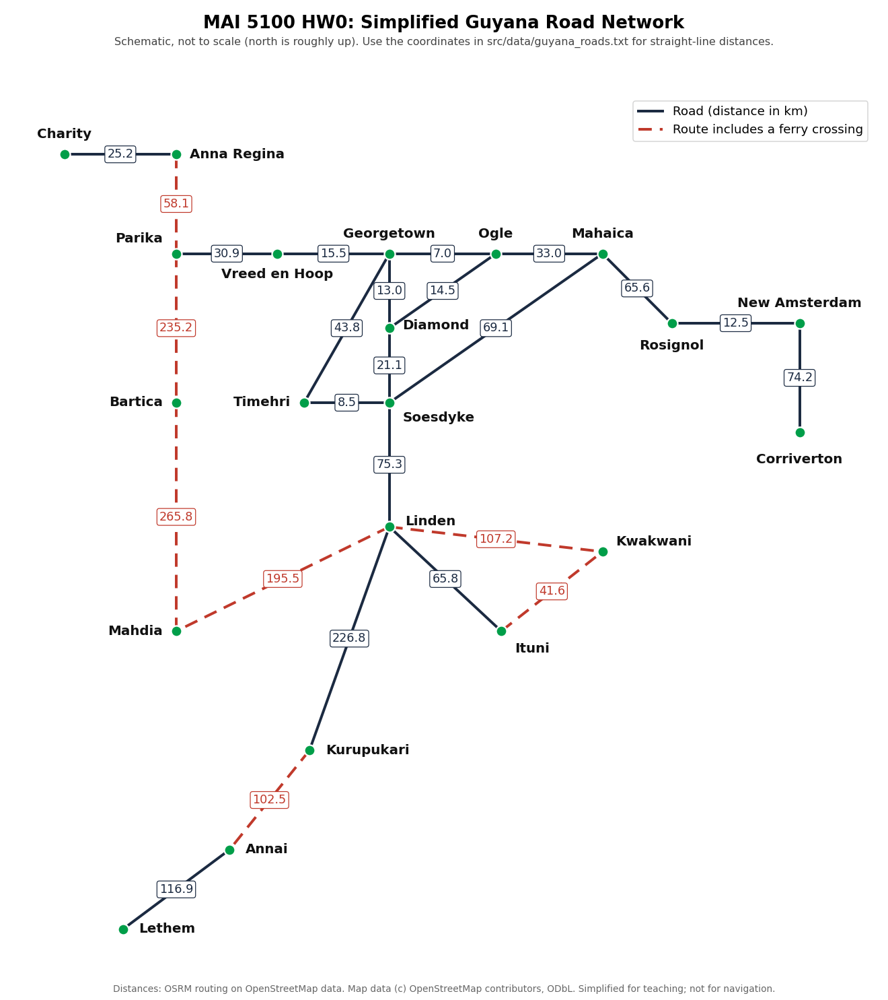

# MAI 5100 Homework 0: Search

**Released:** Saturday, October 31, 2026
**Due:** **Saturday, November 21, 2026 at 11:59 PM (Guyana time)**


This homework covers everything from Weeks 2 and 3: problem formulation, uninformed search (DFS, BFS, UCS), and informed search (greedy, A*, admissible and consistent heuristics). It goes beyond implementing algorithms. You will also **prove** properties of heuristics, **model a real Guyanese problem** as a search problem, **run experiments**, and **critically compare** classical search with a modern large language model.

| Part | What you do | Points |
|---|---|---|
| [A. Pacman Search](#part-a-pacman-search-25-pts) | Implement search algorithms and heuristics for Pacman (autograded, Q1–Q8) | 25 |
| [B. Written Problems](#part-b-written-problems-25-pts) | Search theory, heuristics, and a hand trace on the Guyana road map | 25 |
| [C. Route Planning in Guyana](#part-c-route-planning-in-guyana-30-pts) | Model and solve a real route-planning problem (autograded Q9–Q10, plus experiments) | 30 |
| [D. Search vs. LLMs](#part-d-search-vs-llms-15-pts) | Compare A* with an LLM on the same problems, and reflect | 15 |
| [Submission quality](#grading) | Git history, PR description, GenAI log | 5 |
| **Total** | | **100** |

## Table of Contents

- [Getting Started](#getting-started)
- [Part A: Pacman Search (25 pts)](#part-a-pacman-search-25-pts)
- [Part B: Written Problems (25 pts)](#part-b-written-problems-25-pts)
- [Part C: Route Planning in Guyana (30 pts)](#part-c-route-planning-in-guyana-30-pts)
- [Part D: Search vs. LLMs (15 pts)](#part-d-search-vs-llms-15-pts)
- [Grading](#grading)
- [Submission](#submission)
- [Academic Integrity and Generative AI](#academic-integrity-and-generative-ai)

## Getting Started

You need **Python 3.10+** and **Git**. No external packages are required for Parts A and C. Part C experiments may optionally use `matplotlib` for plots.

1. **Fork** this repository to your GitHub account and clone your fork.
2. **Create your submission folder** by copying the starter code. Use `firstname_lastname`:
   ```bash
   cd hw/hw0
   mkdir -p submissions/firstname_lastname
   cp -R src submissions/firstname_lastname/src
   cp written_template.md submissions/firstname_lastname/written.md
   cd submissions/firstname_lastname/src
   ```
3. **Check that everything runs** (you should see 0 points; that is expected):
   ```bash
   python autograder.py --no-graphics
   ```

Work **only** inside your submission folder. Do not edit the files in `hw/hw0/src`.

The autograder can run a single question (`python autograder.py -q q2`) or a single test (`python autograder.py -t test_cases/q2/graph_bfs_vs_dfs`). Add `--no-graphics` if graphics do not work on your machine.

**Files you will edit:**

| File | Part | What goes in it |
|---|---|---|
| `src/search.py` | A, C | DFS, BFS, UCS, A* |
| `src/searchAgents.py` | A | Corners problem, heuristics, closest-dot search |
| `src/guyanaRoutes.py` | C | Guyana route problem, straight-line heuristic, greedy search |
| `written.md` | B, C, D | All written answers, experiment results, and reflections |

**Files you might want to look at:** `pacman.py` (the `GameState` type), `game.py` (`Directions`, `Grid`), `util.py` (`Stack`, `Queue`, `PriorityQueue`), and `data/guyana_roads.txt` (the road network for Part C).

---

## Part A: Pacman Search (25 pts)

*Lectures 2–3. Autograded: questions q1–q8.*

In this part, your Pacman agent will find paths through his maze world, both to reach a particular location and to collect food efficiently. You will build general search algorithms and apply them to Pacman scenarios. Part A is adapted from UC Berkeley CS 188 Project 1.

### Welcome to Pacman

Run Pacman:

After setting up your submission folder (see [Getting Started](#getting-started)) and changing into its `src` directory, you should be able to play a game of Pacman by typing the following at the command line:

```bash
python pacman.py
```

Pacman lives in a shiny blue world of twisting corridors and tasty round treats. Navigating this world efficiently will be Pacman’s first step in mastering his domain.

The simplest agent in searchAgents.py is called the GoWestAgent, which always goes West (a trivial reflex agent). This agent can occasionally win:

```bash
python pacman.py --layout testMaze --pacman GoWestAgent
```

But, things get ugly for this agent when turning is required:

```bash
python pacman.py --layout tinyMaze --pacman GoWestAgent
```

If Pacman gets stuck, you can exit the game by typing `CTRL-c` into your terminal.

Soon, your agent will solve not only `tinyMaze`, but any maze you want.

Note that `pacman.py` supports a number of options that can each be expressed in a long way (e.g., `--layout`) or a short way (e.g., `-l`). You can see the list of all options and their default values via:

```bash
python pacman.py -h
```

### New Syntax

You may not have seen this syntax before:

```python
def my_function(a: int, b: Tuple[int, int], c: List[List], d: Any, e: float=1.0):
```

This is a Python 3 function definition. The `:` after the variable name indicates the type of the variable. For example, `a: int` means that `a` is an integer. The `Tuple[int, int]` means that `b` is a tuple of two integers. The `List[List]` means that `c` is a list of lists. The `Any` type means that `d` can be any type. The `float=1.0` means that `e` is a float with a default value of 1.0.

```python
my_function(1, (2, 3), [['a', 'b'], [None, my_class], [[]]], ('h', 1)) 
```

The above call fits the type annotations, and doesn’t pass anything in for e. Type annotations are meant to be an adddition to the docstrings to help you know what the functions are working with. Python itself doesn’t enforce these. When writing your own functions, it is up to you if you want to annotate your types; they may be helpful to keep organized or not something you want to spend time on.


### Q1 (3 pts): Finding a Fixed Food Dot using Depth First Search

In `searchAgents.py`, you’ll find a fully implemented `SearchAgent`, which plans out a path through Pacman’s world and then executes that path step-by-step. The search algorithms for formulating a plan are not implemented—that’s your job.

First, test that the `SearchAgent` is working correctly by running:

```bash
python pacman.py -l tinyMaze -p SearchAgent -a fn=tinyMazeSearch
```

The command above tells the `SearchAgent` to use `tinyMazeSearch` as its search algorithm, which is implemented in `search.py`. Pacman should navigate the maze successfully.

Now it’s time to write full-fledged generic search functions to help Pacman plan routes! Pseudocode for the search algorithms you’ll write can be found in the lecture slides. Remember that a search node must contain not only a state but also the information necessary to reconstruct the path (plan) which gets to that state.

**Important note:** All of your search functions need to return a list of actions that will lead the agent from the start to the goal. These actions all have to be legal moves (valid directions, no moving through walls).

**Important note:** Make sure to use the `Stack`, `Queue`, and `PriorityQueue` data structures provided to you in `util.py`! These data structure implementations have particular properties which are required for compatibility with the autograder.

**Hint:** Each algorithm is very similar. Algorithms for DFS, BFS, UCS, and A* differ only in the details of how the fringe is managed. So, concentrate on getting DFS right, and the rest should be relatively straightforward. Indeed, one possible implementation requires only a single generic search method which is configured with an algorithm-specific queuing strategy. (Your implementation need not be of this form to receive full credit.)

Implement the **depth-first search (DFS)** algorithm in the `depthFirstSearch` function in `search.py`. To make your algorithm complete, write the graph search version of DFS, which avoids expanding any already visited states.

Your code should quickly find a solution for:

```bash
python pacman.py -l tinyMaze -p SearchAgent

python pacman.py -l mediumMaze -p SearchAgent

python pacman.py -l bigMaze -z .5 -p SearchAgent
```

The Pacman board will show an overlay of the states explored, and the order in which they were explored (brighter red means earlier exploration). Is the exploration order what you would have expected? Does Pacman actually go to all the explored squares on his way to the goal?

**Hint:** If you use a `Stack` as your data structure, the solution found by your DFS algorithm for `mediumMaze` should have a length of **130** (provided you push successors onto the fringe in the order provided by `getSuccessors`; you might get **246** if you push them in the reverse order). Is this a least-cost solution? If not, think about what depth-first search is doing wrong.

**Grading:** Please run the command below to see if your implementation passes all the autograder test cases.

```bash
python autograder.py -q q1
```


### Q2 (3 pts): Breadth First Search

Implement the **breadth-first search (BFS)** algorithm in the `breadthFirstSearch` function in `search.py`. Again, write a graph search algorithm that avoids expanding any already visited states. Test your code the same way you did for depth-first search.

```bash
python pacman.py -l mediumMaze -p SearchAgent -a fn=bfs

python pacman.py -l bigMaze -p SearchAgent -a fn=bfs -z .5
```

Does BFS find a least-cost solution? If not, check your implementation.

**Hint:** If Pacman moves too slowly for you, try the option `--frameTime 0`.

**Note:** If you’ve written your search code generically, your code should work equally well for the eight-puzzle search problem without any changes.

```bash
python eightpuzzle.py
```

Grading: Please run the below command to see if your implementation passes all the autograder test cases.

```bash
python autograder.py -q q2
```

### Q3 (3 pts): Varying the Cost Function

While BFS will find a fewest-actions path to the goal, we might want to find paths that are “best” in other senses. Consider `mediumDottedMaze` and `mediumScaryMaze`.

By changing the cost function, we can encourage Pacman to find different paths. For example, we can charge more for dangerous steps in ghost-ridden areas or less for steps in food-rich areas, and a rational Pacman agent should adjust its behavior in response.

Implement the **uniform-cost graph search** algorithm in the `uniformCostSearch` function in `search.py`. We encourage you to look through `util.py` for some data structures that may be useful in your implementation. You should now observe successful behavior in all three of the following layouts, where the agents below are all UCS agents that differ only in the cost function they use (the agents and cost functions are written for you):

```bash
python pacman.py -l mediumMaze -p SearchAgent -a fn=ucs

python pacman.py -l mediumDottedMaze -p StayEastSearchAgent

python pacman.py -l mediumScaryMaze -p StayWestSearchAgent
```

**Note:** You should get very low and very high path costs for the `StayEastSearchAgent` and `StayWestSearchAgent` respectively, due to their exponential cost functions (see `searchAgents.py` for details).

**Grading:** Please run the command below to see if your implementation passes all the autograder test cases.

```bash
python autograder.py -q q3
```

### Q4 (3 pts): A* search

Implement **A\* search** in the empty function `aStarSearch` in `search.py`. A\* takes a heuristic function as an argument. Heuristics take two arguments: a state in the search problem (the main argument), and the problem itself (for reference information). The `nullHeuristic` heuristic function in `search.py` is a trivial example.

You can test your A\* implementation on the original problem of finding a path through a maze to a fixed position using the Manhattan distance heuristic (implemented already as `manhattanHeuristic` in `searchAgents.py`).

**Hint:** In addition to keeping track of the visited state, you may also want to keep track of the best path cost to that state so far. Some nodes may need to be expanded more than once to find the optimal path.

```bash
python pacman.py -l bigMaze -z .5 -p SearchAgent -a fn=astar,heuristic=manhattanHeuristic
```

You should see that A* finds the optimal solution slightly faster than uniform cost search (about 549 vs. 620 search nodes expanded in our implementation, but ties in priority may make your numbers differ slightly). What happens on `openMaze` for the various search strategies?

**Grading:** Please run the command below to see if your implementation passes all the autograder test cases.

```bash
python autograder.py -q q4
```

### Q5 (3 pts): Finding All the Corners

The real power of A* will only be apparent with a more challenging search problem. Now, it’s time to formulate a new problem and design a heuristic for it.

In corner mazes, there are four dots, one in each corner. Our new search problem is to find the shortest path through the maze that touches all four corners (whether the maze actually has food there or not). Note that for some mazes like `tinyCorners`, the shortest path does not always go to the closest food first! **Hint:** The shortest path through `tinyCorners` takes **28** steps.

**Note:** Make sure to complete `Question 2` before working on `Question 5`, because `Question 5` builds upon your answer for `Question 2`.

Implement the `CornersProblem` search problem in `searchAgents.py`. You will need to choose a state representation that encodes all the information necessary to detect whether all four corners have been reached. Now, your search agent should solve:

```bash
python pacman.py -l tinyCorners -p SearchAgent -a fn=bfs,prob=CornersProblem

python pacman.py -l mediumCorners -p SearchAgent -a fn=bfs,prob=CornersProblem
```

To receive full credit, you need to define an abstract state representation that does **not** encode irrelevant information (like the position of ghosts, where extra food is, etc.). In particular, **do not** use a Pacman `GameState` as a search state. Your code will be very, very slow if you do (and also wrong).

An instance of the `CornersProblem` class represents an entire search problem, not a particular state. Particular states are returned by the functions you write, and your functions return a data structure of your choosing (e.g., tuple, set, etc.) that represents a state.

Furthermore, while a program is running, remember that many states simultaneously exist, all on the queue of the search algorithm, and they should be independent of each other. In other words, you should not have only one state for the entire `CornersProblem` object; your class should be able to generate many different states to provide to the search algorithm.

**Hint 1:** The only parts of the game state you need to reference in your implementation are the starting Pacman position and the location of the four corners.

**Hint 2:** When coding up `getSuccessors`, make sure to add children to your successors list with a cost of 1.

Our implementation of `breadthFirstSearch` expands just under **2000** search nodes on `mediumCorners`. However, heuristics (used with A* search) can reduce the amount of searching required.

**Grading:** Please run the command below to see if your implementation passes all the autograder test cases.

```bash
python autograder.py -q q5
```

### Q6 (3 pts): Corners Problem: Heuristic

**Note:** Make sure to complete `Question 4` before working on `Question 6`, because `Question 6` builds upon your answer for `Question 4`.

Implement a non-trivial heuristic for the `CornersProblem` in `cornersHeuristic`.

```bash
python pacman.py -l mediumCorners -p AStarCornersAgent -z 0.5
```

**Note:** `AStarCornersAgent` is a shortcut for:

```bash
-p SearchAgent -a fn=aStarSearch,prob=CornersProblem,heuristic=cornersHeuristic
```

**Admissibility:** Remember, heuristics are just functions that take search states and return numbers that estimate the cost to a nearest goal. More effective heuristics will return values closer to the actual goal costs. To be **admissible**, the heuristic values must be lower bounds on the actual shortest path cost to the nearest goal (and non-negative).

**Non-Trivial Heuristics:** The trivial heuristics are the ones that return zero everywhere (UCS) and the heuristic which computes the true completion cost. The former won’t save you any time, while the latter will timeout the autograder. You want a heuristic which reduces total compute time, though for this assignment the autograder will only check node counts (aside from enforcing a reasonable time limit).

**Grading:** Your heuristic must be a non-trivial non-negative heuristic to receive any points. Make sure that your heuristic returns 0 at every goal state and never returns a negative value. Depending on how few nodes your heuristic expands, you’ll be graded:

| Number of nodes expanded | Grade |
|--------------------------|-------|
| more than 2000           | 0/3   |
| at most 2000             | 1/3   |
| at most 1600             | 2/3   |
| at most 1200             | 3/3   |

**Grading:** Please run the command below to see if your implementation passes all the autograder test cases.

```bash
python autograder.py -q q6
```

### Q7 (4 pts): Eating All The Dots

Now we’ll solve a hard search problem: eating all the Pacman food in as few steps as possible. For this, we’ll need a new search problem definition which formalizes the food-clearing problem: `FoodSearchProblem` in `searchAgents.py` (implemented for you). A solution is defined to be a path that collects all of the food in the Pacman world. For the present project, solutions do not take into account any ghosts or power pellets; solutions only depend on the placement of walls, regular food, and Pacman. (Of course, ghosts can ruin the execution of a solution! We’ll get to that in the next project.)

If you have written your general search methods correctly, A* with a null heuristic (equivalent to uniform-cost search) should quickly find an optimal solution to `testSearch` with no code change on your part (total cost of **7**).

```bash
python pacman.py -l testSearch -p AStarFoodSearchAgent
```

**Note:** `AStarFoodSearchAgent` is a shortcut for:

```bash
-p SearchAgent -a fn=astar,prob=FoodSearchProblem,heuristic=foodHeuristic
```

You should find that UCS starts to slow down even for the seemingly simple `tinySearch`. As a reference, our implementation takes 2.5 seconds to find a path of length **27** after expanding **5057** search nodes.

**Note:** Make sure to complete `Question 4` before working on `Question 7`, because `Question 7` builds upon your answer for `Question 4`.

Fill in `foodHeuristic` in `searchAgents.py` with a heuristic for the `FoodSearchProblem`. Try your agent on the `trickySearch` board:

```bash
python pacman.py -l trickySearch -p AStarFoodSearchAgent
```

Our UCS agent finds the optimal solution in about **13 seconds**, exploring over **16,000** nodes.

Any non-trivial non-negative heuristic will receive **1 point**. Make sure that your heuristic returns **0** at every goal state and never returns a negative value. Depending on how few nodes your heuristic expands, you’ll get additional points:

| Number of nodes expanded | Grade                               |
|--------------------------|-------------------------------------|
| more than 15000          | 1/4                                 |
| at most 15000            | 2/4                                 |
| at most 12000            | 3/4                                 |
| at most 9000             | 4/4 (full credit; medium)           |
| at most 7000             | 5/4 (optional extra credit; hard)   |

**Grading:** Please run the command below to see if your implementation passes all the autograder test cases.

```bash
python autograder.py -q q7
```

### Q8 (3 pts): Suboptimal Search

Sometimes, even with A* and a good heuristic, finding the optimal path through all the dots is hard. In these cases, we’d still like to find a reasonably good path quickly. In this section, you’ll write an agent that always greedily eats the closest dot. `ClosestDotSearchAgent` is implemented for you in `searchAgents.py`, but it’s missing a key function that finds a path to the closest dot.

Implement the function `findPathToClosestDot` in `searchAgents.py`. Our agent solves this maze (suboptimally!) in under a second with a path cost of **350**:

```bash
python pacman.py -l bigSearch -p ClosestDotSearchAgent -z .5
```

**Hint:** The quickest way to complete `findPathToClosestDot` is to fill in the `AnyFoodSearchProblem`, which is missing its goal test. Then, solve that problem with an appropriate search function. The solution should be very short!

Your `ClosestDotSearchAgent` won’t always find the shortest possible path through the maze. Make sure you understand why, and try to come up with a small example where repeatedly going to the closest dot does not result in finding the shortest path for eating all the dots.

**Grading:** Please run the command below to see if your implementation passes all the autograder test cases.

```bash
python autograder.py -q q8
```


---

## Part B: Written Problems (25 pts)

*Write all answers in `written.md`. Show your work. Hand-drawn diagrams are fine if you photograph them clearly and add them to your submission folder.*

### B1. State spaces and uninformed search (7 pts) — R&N 3.15

Consider a state space where the start state is number 1 and each state $k$ has two successors: numbers $2k$ and $2k + 1$.

1. Draw the portion of the state space for states 1 to 15.
2. Suppose the goal state is 11. List the order in which nodes will be visited for breadth-first search, depth-limited search with limit 3, and iterative deepening search.
3. How well would bidirectional search work on this problem? What is the branching factor in each direction?
4. Call the action going from $k$ to $2k$ **Left** and the action going to $2k + 1$ **Right**. Give an algorithm that outputs the solution for any goal $g$ **without any search**. What does this tell you about the value of a good problem formulation?

### B2. Problem formulation and heuristics (6 pts) — R&N 3.27

$n$ vehicles occupy squares $(1,1)$ through $(n,1)$ (the bottom row) of an $n \times n$ grid. The vehicles must be moved to the top row in reverse order: vehicle $i$ that starts in $(i,1)$ must end up in $(n - i + 1, n)$. On each time step, every vehicle can move one square up, down, left, or right, or stay put; but if a vehicle stays put, one adjacent vehicle (but not more than one) can hop over it. Two vehicles cannot occupy the same square.

1. Calculate the size of the state space as a function of $n$.
2. Calculate the branching factor as a function of $n$.
3. Write a nontrivial admissible heuristic $h_i$ for vehicle $i$ at $(x, y)$, assuming no other vehicles are on the grid.
4. Which of these heuristics are admissible for moving **all** $n$ vehicles? Explain each: (a) $\sum_i h_i$, (b) $\max_i h_i$, (c) $\min_i h_i$.

### B3. Proofs about heuristics (6 pts)

1. **Consistency implies admissibility.** Prove that if $h$ is consistent and $h(\text{goal}) = 0$, then $h$ is admissible.
2. **Combining heuristics.** Let $h_1$ and $h_2$ be admissible. Prove that $h(n) = \max(h_1(n), h_2(n))$ is admissible. Is $h_1(n) + h_2(n)$ admissible? Prove it or give a counterexample.
3. **Inflated heuristics.** Weighted A* uses $f(n) = g(n) + w \cdot h(n)$ with $w > 1$ and an admissible $h$. Show that the cost of the solution it returns is at most $w$ times the optimal cost (you may assume tree search with a consistent $h$). Why might someone accept a suboptimal answer?

### B4. Hand trace on the Guyana road map (6 pts)

Use the simplified Guyana road network below (distances in km, from `src/data/guyana_roads.txt`). The diagram is a schematic: town positions are arranged for readability, not drawn to scale.

<p align="center">
  
</p>

Plan a route from **Bartica** to **Ituni**. Use graph search, break ties alphabetically, and use straight-line distance to Ituni as the A* heuristic. Compute the straight-line distances with `haversineKm` from `guyanaRoutes.py` and include the values you used in a table.

1. For **BFS**, **UCS**, and **A\***, list the nodes in the order they are **expanded**, with the fringe and each node's $g$ (and $h$, $f$ for A\*) at every step.
2. Report the route and total cost each algorithm returns, and state whether each is optimal.
3. Explain, in terms of the fringe, **why** A* expanded fewer nodes than UCS (or why it did not).

---

## Part C: Route Planning in Guyana (30 pts)

*Autograded: q9 and q10 (20 pts total, 10 each after rescaling). Experiments and analysis in `written.md` (10 pts).*

The algorithms you wrote in Part A are **general**: they work on any problem that implements the `SearchProblem` interface. In this part you will use them on a problem that has nothing to do with Pacman: finding routes between towns in Guyana.

The file `src/data/guyana_roads.txt` describes 21 towns and 25 two-way roads. Town coordinates come from OpenStreetMap, and road distances and drive times were computed with the OSRM routing engine on OpenStreetMap data. Some routes include a **ferry crossing** (for example, across the Essequibo or Berbice rivers); these are slow even when they are short. The network is simplified for teaching, so do not use it for real navigation.

All your Part C code goes in `src/guyanaRoutes.py`. `RoadMap` (which loads the data) and `haversineKm` (straight-line distance) are already written for you.

### Q9 (10 pts): Model the problem, then search greedily

1. Complete `GuyanaRouteProblem`. A **state** is a town name. An **action** is the name of the next town. The **step cost** depends on `costMode`: road kilometres (`"km"`) or travel hours (`"hours"`). Remember that `getCostOfActions` must return `999999` for an invalid route.
2. Implement `greedySearch` (greedy best-first graph search). It always expands the node with the smallest $h(n)$, ignoring $g(n)$.
3. Implement `straightLineHeuristic` for `costMode == "km"`.

```bash
python autograder.py -q q9
```

### Q10 (10 pts): An admissible heuristic for both cost modes

`straightLineHeuristic` must be **admissible**, **consistent**, and **non-trivial** (not zero everywhere) for **both** cost modes. For `"km"`, straight-line distance works directly. For `"hours"` you must convert a distance into a time that can never overestimate the true travel time. Think about the fastest any segment of this network can be travelled, and justify your choice in `written.md`.

Q10 checks your heuristic on every town for several goals, and checks that A* (using **your** `aStarSearch` from Part A) finds optimal routes while expanding no more nodes than UCS.

```bash
python autograder.py -q q10
```

### C3. Experiments and analysis (10 pts)

Once Q9 and Q10 pass, you can compare all five algorithms on any query:

```bash
python guyanaRoutes.py Georgetown Lethem km
python guyanaRoutes.py Charity Corriverton hours
```

In `written.md`:

1. **Results table (4 pts).** Choose at least **five** start/goal pairs, covering both cost modes and at least one route involving a ferry. For each pair and algorithm (BFS, DFS, UCS, Greedy, A\*), report cost, nodes expanded, and runtime. A plot is welcome but not required.
2. **Analysis (4 pts).** Which algorithms were optimal, and when? When did greedy search fail, and why? How much did the heuristic reduce expansions for A* compared with UCS? Did the best route change between `km` and `hours`? Explain using the ferry routes.
3. **Formulation critique (2 pts).** Name **two** things that real travel in Guyana depends on that this model ignores (for example, ferry schedules, road conditions in the rainy season, or the Linden–Lethem road surface). For one of them, describe how you would change the state, actions, or costs to capture it, and what that does to the size of the search space.

---

## Part D: Search vs. LLMs (15 pts)

Large language models can "plan routes" and "solve puzzles". But are they doing search? In this part you will find out.

1. **Run the comparison (6 pts).** Pick **three** of your Part C queries and **two** 8-puzzle instances. Run `python eightpuzzle.py` to get a random puzzle and its optimal solution from your BFS (press Enter to step through the moves). Give each one to an LLM of your choice (for example ChatGPT, Claude, Gemini, or Copilot) with the same information your algorithm had: the road list, or the puzzle. Record the exact prompt, the model and version, and the full response in `written.md`.
2. **Evaluate (5 pts).** For each instance: Is the LLM's answer **valid** (a real route or legal moves)? Is it **optimal** compared with A* or BFS? Did it make up roads, distances, or moves? Summarize in a table.
3. **Reflect (4 pts).** In 200–300 words: What can an algorithm like A* **guarantee** that an LLM cannot? When would you still prefer an LLM? How could you combine them, for example by letting an LLM *formulate* a search problem and A* *solve* it?

---

## Grading

| Component | Points | How it is graded |
|---|---|---|
| Part A (q1–q8) | 25 | Autograder (25 points; the q7 bonus point counts as extra credit) |
| Part B | 25 | Written, by rubric |
| Part C: q9, q10 | 20 | Autograder (4 points each, rescaled to 10 each), plus hidden tests on additional queries |
| Part C: C3 | 10 | Written, by rubric |
| Part D | 15 | Written, by rubric |
| Submission quality | 5 | Meaningful commit history, complete PR description, honest GenAI log |
| **Total** | **100** | |

The autograder in this repository is a **self-check**. Your final Part A and C grades also include hidden test cases, and your code may be reviewed by hand. The correctness of your implementation, not the autograder's judgement, determines your score.

**Late policy:** Homeworks cannot be turned in late unless an extension is granted at least 24 hours before the deadline.

---

## Submission

Submit by opening a **pull request** from your fork to `ChrisIsKing/MAI5100` before the deadline.

1. Commit as you go, with descriptive messages (for example, `Implement UCS with a priority queue` or `Add admissible hours heuristic for Guyana routes`). Your commit history is part of your grade.
2. Your submission folder must contain:
   ```
   hw/hw0/submissions/firstname_lastname/
   ├── src/            # your full copy of the starter code, with your solutions
   └── written.md      # Parts B, C3, and D, plus your GenAI log
   ```
3. Do **not** modify anything outside your own submission folder.
4. Open a pull request titled `HW0: Firstname Lastname`. Fill in the pull request template: your autograder output and short answers to the reflection questions.

---

## Academic Integrity and Generative AI

- You may discuss ideas with classmates, but **all code and written answers must be your own**.
- Generative AI may be used as a **collaborator**, for example to explain a concept or help debug, but you must **log every use** in the GenAI section of `written.md`: the tool, what you asked, and how you used the answer. Part D requires LLM use and is logged there separately.
- You must understand everything you submit. You may be asked to explain your code or answers.
- Solutions to the original CS 188 project exist online. Copying them, or submitting AI-generated code you cannot explain, is an academic violation.

---

*Part A and the Pacman framework are adapted from the [UC Berkeley CS 188 Pac-Man Projects](https://inst.eecs.berkeley.edu/~cs188/fa26/projects/) by John DeNero, Dan Klein, Pieter Abbeel, and others, used for educational purposes. Guyana map data © OpenStreetMap contributors (ODbL).*
